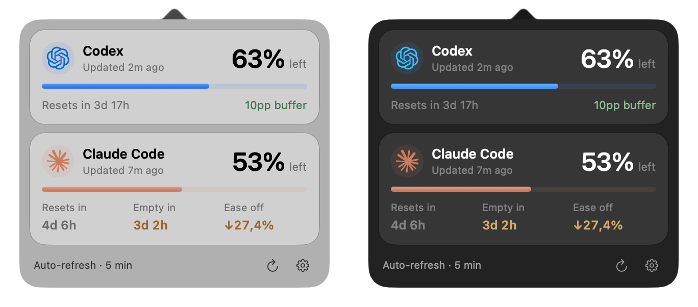

# Veil

A small native macOS menu bar app and CLI that show your remaining weekly allowance for Codex and Claude Code.

This is a purely personal project. I built it for my own use and am sharing the source as-is, with no promise of support or updates.



## Run

Requires macOS 27, Swift 6.2 or newer, and existing Codex and Claude Code CLI logins.

```sh
./scripts/run
```

Veil reads your existing CLI logins without refreshing or changing them. It uses private usage APIs and may break if they change.

## CLI

Build the standalone command without the menu bar app:

```sh
swift build -c release --product veil
install -d "$HOME/.local/bin"
install "$(swift build -c release --show-bin-path)/veil" "$HOME/.local/bin/veil"
```

With `~/.local/bin` on your `PATH`:

```sh
veil                 # Both providers
veil codex           # Codex only (or: veil claude)
veil --json          # Structured output for scripts
veil --help
```

Example output (sample values):

```text
Codex        63% left
  Resets in 3d 0h · 20pp buffer

Claude Code  20% left
  Resets in 3d 0h · Empty in 1d 0h · Ease off 66.7%
```

Buffer is current budget headroom in percentage points, not predicted leftovers. Pace uses average consumption since the weekly window began.

Each invocation fetches fresh usage, with both providers checked concurrently. It runs without the app, has no external dependencies, and never launches a GUI. Provider failures do not hide the other reading. Exit status is `0` when all selected readings are current, `1` if any are unavailable or out of date, and `2` for invalid arguments.

JSON contains a `providers` array in Codex/Claude order, stable provider and status identifiers, percentages, UTC ISO 8601 observation/reset dates, and pace details. Unavailable or expired percentages are omitted, not reported as zero. Errors include a code, recovery message, and `retry_at` for rate limits. Human-readable times use your local timezone.

Both surfaces honor provider cooldowns, including across launches, using only retry timestamps in `~/Library/Caches/Veil`. No credentials or usage readings are saved there. Persistence is best effort if that directory is unwritable. `CODEX_HOME`, `CLAUDE_CONFIG_DIR`, and `CLAUDE_SECURESTORAGE_CONFIG_DIR` are supported; overrides must be absolute. A missing custom-profile login never falls back to the default account.

## Develop

`./scripts/build` builds both executables and bundles the app; add `release` for optimized builds. The app product is named `VeilApp` to avoid colliding with `veil` on case-insensitive filesystems. Both use the same Swift allowance and provider modules, with no AppKit or SwiftUI in the CLI.

```sh
swift test
xcrun swift-format lint --strict --recursive Sources Tests Package.swift
```

If Swift 6.4 Command Line Tools report a missing `TestingMacros` plugin, point the compiler at the installed copy:

```sh
swift test -Xswiftc -load-plugin-library \
  -Xswiftc "$(xcode-select -p)/usr/lib/swift/host/plugins/testing/libTestingMacros.dylib"
```

## License

[MIT](LICENSE). See the [provider artwork credits](Sources/Veil/Resources/Artwork.md) for attribution.

Inspired by [CodexBar](https://github.com/steipete/CodexBar) and [tinybar](https://github.com/ThiloReintjes/tinybar).
